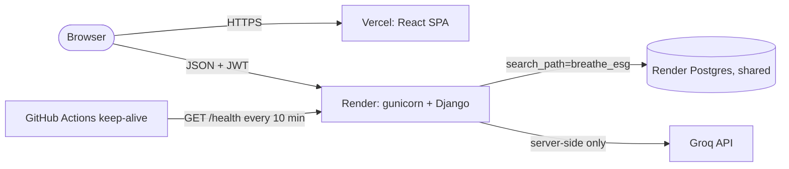

# Deployment guide

Breathe ESG deploys as three pieces:

| Piece | Host | Defined by |
|---|---|---|
| Django REST API | Render web service (free plan, native Python) | [`render.yaml`](../render.yaml), [`backend/build.sh`](../backend/build.sh) |
| PostgreSQL | One **shared** Render PostgreSQL database | created once by hand, not in the Blueprint |
| React SPA | Vercel | [`app/vercel.json`](../app/vercel.json) |

## 1. Database (shared Render PostgreSQL)

Render's free plan allows one Postgres database per account, so several apps
share it. Each app keeps its tables in its own schema; this one uses
`DB_SCHEMA=breathe_esg`. The schema is created automatically
(`CREATE SCHEMA IF NOT EXISTS`) when Django first connects, and every
connection sets `search_path` to it, so migrations never touch other apps'
tables.

1. If the shared database does not exist yet: Render dashboard -> **New** ->
   **PostgreSQL**, plan *Free*.
2. Copy its **Internal Database URL** (same region as the API) for `DATABASE_URL`.

## 2. Backend (Render Blueprint)

1. Render dashboard -> **New** -> **Blueprint** -> select this repository.
   Render reads `render.yaml` and proposes the `breathe-esg-api` web service.
2. Fill in the `sync: false` variables:
   - `DATABASE_URL`: the shared database URL from step 1
   - `FRONTEND_URL`: your Vercel URL, e.g. `https://breathe-esg.vercel.app`
     (comma-separate several; this is the CORS allow-list)
   - `GROQ_API_KEY`: enables the AI briefing (optional; without it the
     endpoint answers 503 and the UI says AI is not configured)
3. `SECRET_KEY` and `JWT_SECRET` are generated by Render. `DEBUG=False`,
   `DB_SCHEMA` and `PYTHON_VERSION` are set inline.
4. Deploy. `build.sh` installs pinned requirements, runs `collectstatic`,
   `migrate` and the idempotent `seed_db` (demo tenant, users, and the four
   sample files pushed through the real pipeline).
5. Check `https://<service>.onrender.com/health` returns
   `{"status": "ok", "db": "ok"}`.

The Render hostname is added to `ALLOWED_HOSTS` automatically from
`RENDER_EXTERNAL_HOSTNAME`.

## 3. Frontend (Vercel)

1. Vercel -> **Add New** -> **Project** -> import the repository.
2. **Root Directory**: `app`. Framework preset Vite is detected; build
   `npm run build`, output `dist` (also pinned in `vercel.json`).
3. Environment variable `VITE_API_URL` = `https://<service>.onrender.com/api`.
4. Deploy, then make sure the Vercel URL is in the backend's `FRONTEND_URL`.

`vercel.json` rewrites every route to `index.html` (client-side routing) and
adds basic security and caching headers. No Vercel cron is configured: Hobby
crons only run daily.

## 4. Keep-alive

Free Render services sleep after 15 idle minutes and take 30 to 60 seconds to
wake. `.github/workflows/keep-alive.yml` calls `/health` every 10 minutes,
which also exercises the database connection.

GitHub -> repository **Settings** -> **Secrets and variables** -> **Actions**
-> **Variables** -> add `BACKEND_URL` = `https://<service>.onrender.com`.
Without it the workflow exits with a notice. The frontend additionally pings
`/health` when the landing and sign-in pages load and shows a "waking up the
server" banner whenever a request takes longer than 4 seconds.

## 5. Post-deploy checklist

- [ ] `/health` returns 200 with `db: ok`
- [ ] Landing page loads on Vercel; sign in with the Reviewer demo account
- [ ] Dashboard shows the seeded data; **Generate briefing** returns an AI summary
- [ ] Approve a record in the review queue and see it in the audit log
- [ ] Browser console shows no CORS errors (otherwise fix `FRONTEND_URL`)

## Troubleshooting

| Symptom | Fix |
|---|---|
| CORS error in the browser | `FRONTEND_URL` must match the Vercel origin exactly, including `https://`, without a trailing path |
| `/health` returns 503 | `DATABASE_URL` wrong or the database is unavailable |
| Build fails at `migrate` | Database URL must be reachable from the build (use the internal URL in the same region) |
| AI briefing says "not configured" | Set `GROQ_API_KEY` on the Render service and redeploy |
| First request takes ~60 s | Expected cold start on the free plan; the keep-alive workflow prevents it |
